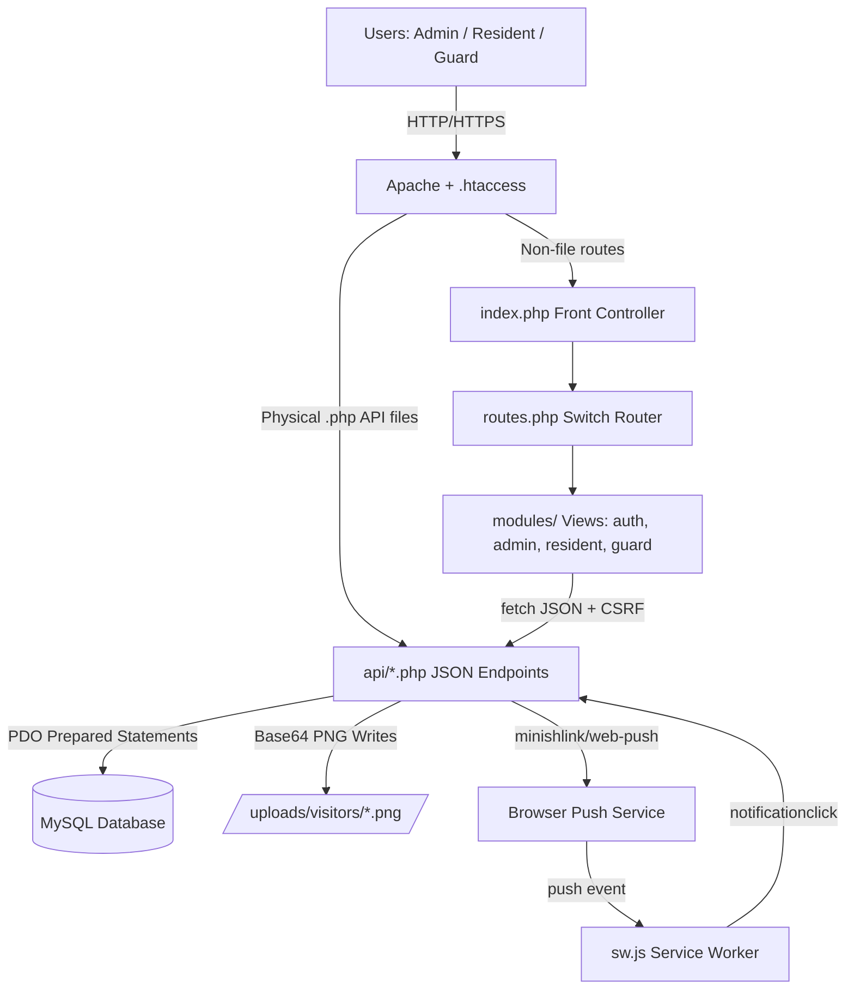

# System Architecture

## Architectural Style
`society_app` uses a **hybrid Front-Controller + Direct-API PHP architecture** without a formal MVC framework:
- **Page Requests**: Routed through Apache `.htaccess` to `index.php`, which initializes PHP sessions, loads `config/db.php`, `includes/auth_middleware.php`, and `includes/csrf.php`, then dispatches to `routes.php` to include a page module under `modules/`.
- **API Requests**: Executed directly by Apache (`.htaccess` skips rewriting for physical files via `RewriteCond %{REQUEST_FILENAME} !-f`) against standalone procedural PHP endpoints in `api/*.php`.
- **Frontend Communication**: Server-rendered PHP/HTML views embed a session CSRF token and interact asynchronously with `api/*.php` using `fetch()` and JSON payloads.

## High-Level Architecture Diagram



## Folder Structure

```text
society_app/
├── .htaccess                  # Apache rewrite rules to index.php for clean routes
├── index.php                  # Front controller: session_start, db, auth_middleware, csrf, routes
├── routes.php                 # URI switch-case dispatcher
├── composer.json / .lock      # PHP dependencies (minishlink/web-push, guzzle7-adapter)
├── manifest.json              # Root PWA manifest (used by auth/login & resident/dashboard)
├── sw.js                      # Service worker for Web Push & Approve/Deny actions
├── test.php                   # Composer autoload verification script
├── test_push_trigger.php      # Manual Web Push test script
├── config/
│   ├── db.php                 # PDO MySQL connection & Asia/Kolkata timezone setup
│   └── db.sql                 # Partial initial schema (4 core tables only)
├── includes/
│   ├── auth_middleware.php    # requireLogin(), requireAdmin(), hasRole()
│   ├── csrf.php               # CSRF token generation, field helper, verification
│   ├── header.php             # Unused shared HTML header (links to /pwa/manifest.json)
│   └── footer.php             # Unused shared HTML footer (links to /pwa/sw.js)
├── assets/
│   ├── css/style.css          # Fade animations & custom radio CSS
│   ├── js/app.js              # Global DOMContentLoaded log & formatDisplayDate()
│   ├── js/tailwind-config.js  # Shared Tailwind theme config for admin views
│   ├── icon-192.svg / 512.svg # SVG PWA icons
│   └── images/                # Empty directory
├── modules/
│   ├── auth/                  # Active login.php, register.php, broken logout.php
│   ├── admin/                 # dashboard, users, notices, financials, guards, complaints, settings, navbar, legacy residents.php
│   ├── guard/                 # dashboard.php (Gatekeeper Terminal)
│   └── resident/              # Active dashboard.php, financials.php; legacy mock login.php, register.php, forget-password.php
├── api/                       # 30 procedural JSON endpoints + logout.php
├── pwa/manifest.json          # Alternate unused PWA manifest
├── uploads/visitors/          # Captured visitor PNG photos (44 files, ~32.8 MB)
└── vendor/                    # Composer packages
```

## Request & Data Flow

### 1. Authentication Flow
1. User visits `/society_app/login` → `.htaccess` → `index.php` → `routes.php` → `modules/auth/login.php`.
2. Form submits JSON (`email`, `password`, `csrf_token`) to `/society_app/api/login.php`.
3. `api/login.php` queries `sms_users` joined with `sms_user_profiles` and `sms_user_units`, verifies `password_verify()`, checks `status === 'active'`, updates `last_login`, and sets `$_SESSION['user_id', 'society_id', 'role_id', 'first_name', 'unit_number', 'logged_in']`.
4. `modules/auth/login.php` reloads `result.data.redirect` (`""` → `/login`), which triggers PHP's session redirect to `/admin/dashboard` (roles 1, 2) or `/resident/dashboard` (all other roles—currently a bug for guards with role 4).

### 2. Visitor Entry & Web Push Flow
1. Guard opens `/guard/dashboard`, captures a Base64 PNG photo via `getUserMedia()` + `<canvas>`, selects a resident unit, and submits to `api/guard_log_visitor.php`.
2. `api/guard_log_visitor.php` writes the PNG to `uploads/visitors/`, inserts a `'Pending'` row into `sms_visitors`, queries `sms_user_push_subscriptions`, and dispatches a VAPID Web Push via `minishlink/web-push`.
3. Meanwhile, `modules/resident/dashboard.php` polls `api/resident_get_pending_visitors.php` every 4 seconds and plays a Web Audio chime + vibration alert.
4. Resident approves/denies either from the dashboard (`api/resident_handle_visitor_approval.php` → sets `'Entered'` / `'Denied'`) or from the Service Worker notification (`sw.js` → `api/update_visitor_status.php` → sets `'Approved'` / `'Denied'`).
5. Guard marks exit via `api/guard_visitor_exit.php` (requires `status = 'Entered'`).

## Third-Party Integrations
- **Tailwind CSS CDN (`cdn.tailwindcss.com`)**: Runtime CSS compilation in browser across all active views.
- **Google Fonts (`fonts.googleapis.com`)**: `Inter` and `Playfair Display`.
- **Web Push Services (FCM / Mozilla / Apple Push)** via `minishlink/web-push` and `guzzlehttp/guzzle`.
- **Unused CDN References** in `includes/header.php`: `sweetalert2@11`, `chart.js`.
