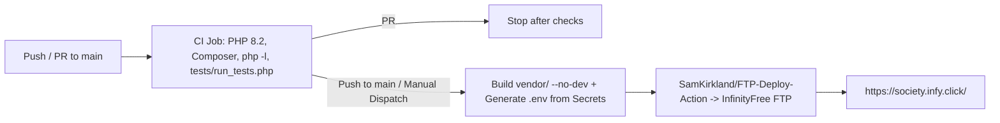

# CI/CD Pipeline Guide (GitHub → InfinityFree FTP)

## Overview
The repository includes a GitHub Actions workflow at [`.github/workflows/ci-cd.yml`](../.github/workflows/ci-cd.yml) that automatically tests and deploys the application from `https://github.com/shopquare/society_app.git` to InfinityFree FTP hosting (`https://society.infy.click/`).



## Root vs Local Subpath Portability
The codebase automatically adapts to both environments via `APP_BASE_PATH` in `.env`:
- **Local XAMPP**: `APP_BASE_PATH=/society_app`
- **InfinityFree Production (`https://society.infy.click/`)**: `APP_BASE_PATH=` (empty string, generated automatically during CI/CD deploy), `APP_URL=https://society.infy.click`
- `.htaccess`, `manifest.json`, `sw.js`, `assets/js/app.js`, and all `modules/` resolve paths dynamically without hardcoded `/society_app` prefixes.

---

## Required GitHub Repository Setup

Go to **GitHub Repository → Settings → Secrets and variables → Actions**.

### 1. Repository Secrets (Required)

| Secret Name | Example / Where to Find It |
|---|---|
| `FTP_SERVER` | `ftpupload.net` (from InfinityFree Client Area → FTP Details) |
| `FTP_USERNAME` | Your InfinityFree FTP username (e.g., `if0_xxxxxxxx`) |
| `FTP_PASSWORD` | Your InfinityFree FTP / vPanel password |
| `APP_KEY` | 64-char hex key (`php -r "echo bin2hex(random_bytes(32));"`) |
| `DB_HOST` | InfinityFree MySQL hostname (e.g., `sqlXXX.infinityfree.com` — **not** `localhost`) |
| `DB_NAME` | Your InfinityFree MySQL database name (e.g., `if0_xxxxxxxx_society`) |
| `DB_USER` | Your InfinityFree MySQL username |
| `DB_PASS` | Your InfinityFree MySQL password |
| `VAPID_SUBJECT` | `mailto:admin@society.infy.click` (or your admin email) |
| `VAPID_PUBLIC_KEY` | Newly generated Web Push VAPID public key |
| `VAPID_PRIVATE_KEY` | Newly generated Web Push VAPID private key |

### 2. Repository Variables (Optional Overrides)

| Variable Name | Default in Workflow | Notes |
|---|---|---|
| `FTP_SERVER_DIR` | `/htdocs/` | Set to `/society.infy.click/htdocs/` if `society.infy.click` is an addon/subdomain folder inside your FTP root instead of `/htdocs/`. |
| `FTP_PROTOCOL` | `ftps` | Switch to `ftp` only if FTPS fails on your runner. |

---

## InfinityFree Hosting Checklist
1. **PHP Version**: In InfinityFree Control Panel (vPanel) → **Alter PHP Directives / Select PHP Version**, ensure PHP **8.2** or **8.3** is selected (required by `minishlink/web-push` v11).
2. **MySQL Schema**: Import [`config/db.sql`](../config/db.sql) into your InfinityFree database via phpMyAdmin, then insert your initial society row in `sms_societies` and admin user in `sms_users` / `sms_user_profiles`.
3. **Verify FTP Target Directory**: Connect once with FileZilla or InfinityFree File Manager to confirm whether `society.infy.click` serves from `/htdocs/` or `/society.infy.click/htdocs/` and set `FTP_SERVER_DIR` accordingly.
4. **Live Uploads Preserved**: The deploy action excludes `**/uploads/**`, `**/.git*`, `**/.github/**`, `**/docs/**`, and `**/tests/**` so live visitor photos on the server are never overwritten.
5. **Protected Files**: `.htaccess` blocks HTTP access to `.env`, `.ftp-deploy-sync-state.json`, `config/`, `includes/`, `modules/`, `vendor/`, and `uploads/`.

---

## Push Commands (Run Locally When Ready)
```bash
git checkout -B main
git add .
git commit -m "Configure hardened app and CI/CD pipeline for InfinityFree"
git push -u origin main
```
