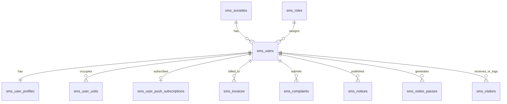

# Database Documentation

## Database Engine & Connection
- **Engine**: MySQL / MariaDB (`mysql:` PDO DSN with `charset=utf8mb4`).
- **Connection File**: `config/db.php` (PDO instance `$conn`, `ERRMODE_EXCEPTION`, `FETCH_ASSOC`, session `time_zone = '+05:30'`).
- **Schema File**: `config/db.sql` (contains **only 4 of the 11 tables** referenced in the codebase).

> [!NOTE]
> The 7 tables not present in `config/db.sql` are documented below based strictly on `SELECT`, `INSERT`, and `UPDATE` queries observed in `api/*.php` and `modules/**/*.php`. No live database connection was executed during this audit.

## Schema Inventory

### A. Tables Defined in `config/db.sql`

1. **`sms_roles`**
   - `id` (`INT AUTO_INCREMENT PRIMARY KEY`)
   - `role_name` (`VARCHAR(50) NOT NULL UNIQUE`)
   - `description` (`VARCHAR(255)`)
   - Observed role IDs in code: `1` (Super Admin), `2` (Committee), `3` (Resident), `4` (Security Guard).

2. **`sms_users`**
   - `id` (`BIGINT AUTO_INCREMENT PRIMARY KEY`)
   - `email` (`VARCHAR(100) NOT NULL UNIQUE`)
   - `password_hash` (`VARCHAR(255) NOT NULL`)
   - `role_id` (`INT NOT NULL`, FK → `sms_roles(id)`)
   - `status` (`ENUM('pending', 'active', 'suspended', 'deactivated') DEFAULT 'pending'`) — *Note: `api/admin_update_status.php` also writes `'rejected'`, indicating the live table likely differs from `db.sql`.*
   - `last_login` (`DATETIME NULL`)
   - `created_at` (`TIMESTAMP DEFAULT CURRENT_TIMESTAMP`)
   - *Additional column observed in PHP queries*: `society_id` (missing in `db.sql`, required by `api/login.php`, `api/register.php`, and all admin APIs).

3. **`sms_user_profiles`**
   - `user_id` (`BIGINT PRIMARY KEY`, FK → `sms_users(id) ON DELETE CASCADE`)
   - `first_name` (`VARCHAR(50) NOT NULL`)
   - `last_name` (`VARCHAR(50) NOT NULL`)
   - `phone_number` (`VARCHAR(20) UNIQUE`)
   - `emergency_contact` (`VARCHAR(20)`)
   - `government_id_type` (`VARCHAR(50)`)
   - `government_id_hash` (`VARCHAR(255)`)

4. **`sms_user_units`**
   - `id` (`BIGINT AUTO_INCREMENT PRIMARY KEY`)
   - `user_id` (`BIGINT NOT NULL`, FK → `sms_users(id) ON DELETE CASCADE`)
   - `unit_number` (`VARCHAR(20) NOT NULL`)
   - `occupancy_type` (`ENUM('owner', 'tenant') NOT NULL`)
   - `move_in_date` (`DATE NOT NULL`)
   - `move_out_date` (`DATE NULL`)
   - `is_current_occupant` (`BOOLEAN DEFAULT TRUE`)
   - *Additional column observed in `api/register.php`*: `society_id` (missing in `db.sql`).

### B. Additional Tables Inferred from Application Queries

5. **`sms_societies`** (queried in `verify_society.php`, `admin_get_society.php`, `admin_update_society.php`, `admin_reset_invite.php`, `modules/resident/dashboard.php`)
   - Observed columns: `id`, `society_code`, `society_name` (note: `modules/resident/dashboard.php` queries `name`, causing a schema mismatch), `address`, `city`, `state`, `zip_code`.

6. **`sms_notices`** (queried in `admin_create_notice.php`, `get_notices.php`)
   - Observed columns: `id`, `society_id`, `created_by`, `title`, `content`, `created_at`.

7. **`sms_invoices`** (queried in `admin_create_invoice.php`, `admin_get_invoices.php`, `resident_get_invoices.php`, `resident_pay_invoice.php`, `modules/resident/dashboard.php`)
   - Observed columns: `id`, `society_id`, `resident_id`, `title`, `amount`, `due_date`, `status` (`'Unpaid'`, `'Paid'`, `'Overdue'`), `created_at`, `updated_at`.

8. **`sms_complaints`** (queried in `resident_create_complaint.php`, `resident_get_complaints.php`, `admin_get_complaints.php`, `admin_update_complaint.php`)
   - Observed columns: `id`, `society_id`, `resident_id`, `category`, `description`, `status` (`'Open'`, `'In Progress'`, `'Resolved'`), `created_at`.

9. **`sms_visitors`** (queried in `guard_log_visitor.php`, `guard_get_visitors.php`, `guard_visitor_exit.php`, `resident_get_pending_visitors.php`, `resident_handle_visitor_approval.php`, `update_visitor_status.php`)
   - Observed columns: `id`, `society_id`, `resident_id`, `guard_id`, `visitor_name`, `phone_number`, `vehicle_number`, `purpose`, `photo_path`, `status` (`'Pending'`, `'Entered'`, `'Denied'`, `'Exited'`, plus `'Approved'` in `update_visitor_status.php`), `entry_time`, `exit_time`.

10. **`sms_visitor_passes`** (queried in `resident_generate_pin.php`, `guard_verify_pin.php`, `modules/resident/dashboard.php`)
    - Observed columns: `id`, `society_id`, `resident_id`, `visitor_name`, `pin_code`, `valid_date`, `status` (`'Active'`, `'Used'`, `'Expired'`), `created_at`.

11. **`sms_user_push_subscriptions`** (queried in `save_push_subscription.php`, `guard_log_visitor.php`, `test_push_trigger.php`)
    - Observed columns: `user_id` (unique/primary key for `ON DUPLICATE KEY UPDATE`), `subscription` (JSON string).

## Entity Relationship Diagram (Inferred + `db.sql`)

## Key Database Findings & Risks
1. **Incomplete `config/db.sql`**: Cannot recreate the database from `config/db.sql` alone; 7 tables and `society_id` columns on `sms_users` / `sms_user_units` are missing.
2. **Column Name Mismatch (`sms_societies.name` vs `society_name`)**: `modules/resident/dashboard.php` selects `s.name` while all society APIs use `society_name`.
3. **Enum Mismatch (`sms_users.status`)**: `db.sql` does not include `'rejected'`, which `api/admin_update_status.php` attempts to set.
4. **Side-Effect Writes on GET**: Both `admin_get_invoices.php` and `resident_get_invoices.php` execute `UPDATE sms_invoices SET status = 'Overdue' ...` inside `GET` endpoints.
5. **Duplicate Row & Performance Risks**:
   - `api/login.php` and `api/admin_get_users.php` join `sms_user_units` without filtering `is_current_occupant = 1`.
   - `api/guard_get_visitors.php` filters `WHERE DATE(v.entry_time) = CURDATE()`, which prevents index usage on `entry_time`.
   - No composite indexes or migrations are tracked in the repository.
6. **Multi-Device Push Limitation**: `sms_user_push_subscriptions` uses `ON DUPLICATE KEY UPDATE` keyed on `user_id`, allowing only one browser/device subscription per resident.
