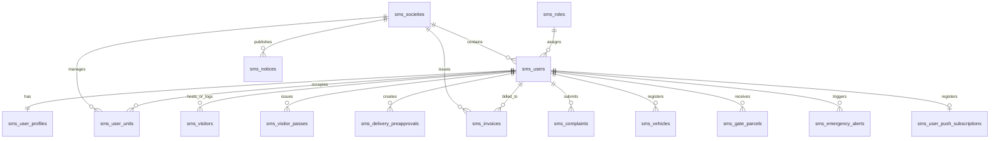

# Database Documentation — SecureGate

## Database Engine & Configuration
* **Engine**: MySQL 8.0+ / MariaDB (`mysql:` PDO DSN with `charset=utf8mb4`).
* **Connection File**: `config/db.php` (PDO instance `$conn`, `ERRMODE_EXCEPTION`, `FETCH_ASSOC`).
* **Session Timezone**: `SET time_zone = '+05:30'` (strictly enforced Indian Standard Time).
* **Migration & Auto-Seeding**: `includes/db_migrator.php` auto-verifies tables on startup and seeds registered accounts.

---

## Complete 29-Table Schema Inventory

### 1. Multi-Tenant Core Tables
* **`sms_societies`**: Stores housing society profiles (`id`, `society_name`, `society_code`, `address`, `city`, `state`, `zip_code`, `created_at`).
* **`sms_roles`**: System role definitions (`1` = Super Admin, `2` = Committee, `3` = Resident, `4` = Guard).
* **`sms_users`**: User authentication records (`id`, `society_id`, `email`, `password_hash`, `role_id`, `status`, `last_login`, `created_at`).
* **`sms_user_profiles`**: Personal details (`user_id`, `first_name`, `last_name`, `phone_number`, `emergency_contact`, `government_id_type`, `government_id_hash`).
* **`sms_user_units`**: Flat occupancy mapping (`id`, `society_id`, `user_id`, `unit_number`, `occupancy_type`, `move_in_date`, `move_out_date`, `is_current_occupant`).

### 2. Security & Gate Operations
* **`sms_visitors`**: Entry/exit log (`id`, `society_id`, `guard_id`, `resident_id`, `visitor_name`, `visitor_tag`, `phone_number`, `vehicle_number`, `purpose`, `photo_path`, `status`, `entry_time`, `exit_time`).
  * Status enum: `'Pending'`, `'Entered'`, `'Denied'`, `'Exited'`.
  * `visitor_tag`: Category / tag classification (`Delivery`, `Food Delivery`, `E-commerce`, `Cab / Taxi`, `Guest`, `Family`, `Friend`, `Service Provider`, `Maintenance`, `Domestic Help`, `Other`).
* **`sms_visitor_passes`**: 6-digit fast-track guest PINs (`id`, `society_id`, `resident_id`, `visitor_name`, `pin_code`, `valid_date`, `valid_until`, `status`, `created_at`).
  * `valid_until`: Strict 48-hour timestamp from generation in Indian Standard Time (`Asia/Kolkata`).
  * Status enum: `'Active'`, `'Used'`, `'Expired'`.
* **`sms_delivery_preapprovals`**: Resident 1-tap passes for Swiggy, Zomato, Amazon, Blinkit, etc. (`id`, `society_id`, `resident_id`, `company`, `instruction`, `valid_until`, `status`, `created_at`).
* **`sms_gate_parcels`**: Deliveries held in gate parcel locker (`id`, `society_id`, `resident_id`, `courier_company`, `recipient_name`, `tracking_number`, `status`, `received_at`, `collected_at`).
* **`sms_vehicles`**: Registered resident vehicles for parking identification (`id`, `society_id`, `resident_id`, `vehicle_number`, `vehicle_type`, `parking_slot`, `created_at`).

### 3. Emergency & Real-Time Incident Response
* **`sms_emergency_alerts`**: Emergency panic alerts (`id`, `society_id`, `resident_id`, `alert_type`, `description`, `latitude`, `longitude`, `status`, `assigned_to`, `resolved_by`, `resolved_at`, `cancelled_at`, `cancellation_reason`, `created_at`).
  * `alert_type`: `'Medical Emergency'`, `'Fire Emergency'`, `'Security Threat'`, `'Accident'`, `'Theft / Suspicious Activity'`, `'Other Emergency'`.
  * `status`: `'Active'`, `'Acknowledged'`, `'Responding'`, `'Resolved'`, `'Cancelled'`.

### 4. Society Management & Community
* **`sms_society_facilities`**: Society amenities (`id`, `society_id`, `name`, `description`, `capacity`, `rules`, `booking_cost_per_slot`, `is_active`, `created_at`).
* **`sms_facility_bookings`**: Slot reservations (`id`, `society_id`, `facility_id`, `resident_id`, `booking_date`, `start_time`, `end_time`, `status`, `notes`, `created_at`).
* **`sms_family_members`**: Unit occupants roster (`id`, `society_id`, `resident_id`, `name`, `relationship`, `phone_number`, `is_emergency_contact`, `created_at`).
* **`sms_domestic_staff`**: Verified society daily staff (`id`, `society_id`, `name`, `role_type`, `phone_number`, `photo_path`, `rating`, `is_verified`, `created_at`).
* **`sms_resident_staff_mapping`**: Association of staff to resident flats (`id`, `society_id`, `resident_id`, `staff_id`, `unit_number`, `created_at`).
* **`sms_notices`**: Society announcements (`id`, `society_id`, `created_by`, `title`, `content`, `created_at`).
* **`sms_invoices`**: Maintenance billing (`id`, `society_id`, `resident_id`, `title`, `amount`, `due_date`, `status`, `created_at`, `updated_at`).
* **`sms_complaints`**: Resident maintenance helpdesk tickets (`id`, `society_id`, `resident_id`, `category`, `description`, `status`, `created_at`).
* **`sms_audit_logs`**: Immutable security audit trail (`id`, `society_id`, `actor_id`, `action`, `target_type`, `target_id`, `details`, `ip_address`, `created_at`).
* **`sms_user_push_subscriptions`**: Web Push VAPID endpoints (`user_id`, `subscription`, `updated_at`).
* **`sms_persistent_tokens`**: "Remember Me" authentication tokens (`id`, `user_id`, `token_hash`, `expires_at`).

### 5. Society Marketplace (Buy & Sell)
* **`sms_marketplace_listings`**: Resident item listings (`id`, `society_id`, `seller_id`, `title`, `description`, `category`, `price`, `condition_type`, `contact_preference`, `contact_phone`, `status`, `created_at`).
* **`sms_marketplace_images`**: Up to 5 photos per listing (`id`, `listing_id`, `image_path`, `is_primary`, `created_at`).
* **`sms_marketplace_saved`**: Bookmarked favorites (`id`, `listing_id`, `user_id`, `created_at`).
* **`sms_marketplace_reports`**: Moderation flag reports (`id`, `listing_id`, `reported_by`, `reason`, `status`, `created_at`).

### 6. Monetization & Advertisements
* **`sms_ad_settings`**: Google AdSense and custom banner settings (`id`, `society_id`, `adsense_enabled`, `adsense_publisher_id`, `adsense_slot_id`, `custom_ads_enabled`, `updated_at`).
* **`sms_advertisement_packages`**: Predefined pricing packages (`id`, `package_name`, `duration_days`, `price`, `description`, `is_active`, `created_at`).
* **`sms_advertisements`**: Multi-tenant external brand & resident ads (`id`, `society_id`, `advertiser_name`, `user_id`, `ad_type`, `title`, `target_url`, `banner_image_path`, `company_name`, `company_logo_path`, `category`, `contact_phone`, `offer_badge`, `cta_text`, `target_audience`, `priority`, `package_id`, `start_date`, `end_date`, `permitted_pages`, `status`, `impressions_count`, `clicks_count`, `created_at`).
  * `category`: `'Food'`, `'Grocery'`, `'Shopping'`, `'Healthcare'`, `'Education'`, `'Services'`, `'Real Estate'`, `'Other'`.
  * `target_audience`: `'all'`, `'owners'`, `'tenants'`.
  * `status`: `'Draft'`, `'Pending'`, `'Active'`, `'Paused'`, `'Expired'`.
* **`sms_advertisement_analytics`**: High-resolution event telemetry (`id`, `advertisement_id`, `society_id`, `event_type`, `user_id`, `ip_address`, `user_agent`, `created_at`).
  * `event_type`: `'impression'`, `'click'`.
* **`sms_advertisement_payments`**: Manual payment verification records (`id`, `society_id`, `advertisement_id`, `user_id`, `amount`, `payment_method`, `payment_reference`, `status`, `verified_by`, `verified_at`, `created_at`).

---

## Entity Relationship Diagram

---

## Cross-Environment Auto-Seeding (`includes/db_migrator.php`)

To guarantee identical behavior across both local developer machines (XAMPP) and live cloud hosting (InfinityFree / AWS / VPS), `ensureRegisteredResidentsSeeded()` automatically executes idempotent `INSERT IGNORE` queries on startup:

* **Unit 101**: John Resident (`resident@demo.com`)
* **Unit A-101**: Arun Yadav (`yarun520@gmail.com`)
* **Unit B-801**: Fateh Singh (`yarun037@gmail.com`)
* **Unit A-32**: Bosdiee Kee (`bosdikee@gmail.com`)
* **Unit C-H**: Laundri Rani (`laundarirani@gmail.com`)
* **Unit B-Ty**: BABY (`ohhyehhbaby@ohh.com`)

This completely eliminates missing resident records when deploying to fresh production databases.
