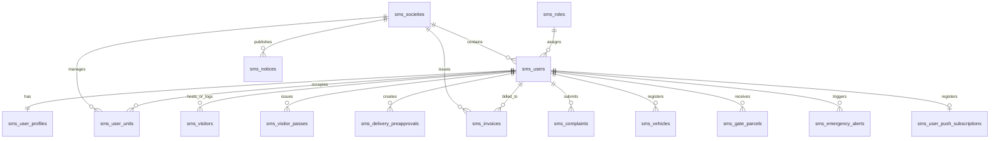

# Database Documentation — SecureGate

## Database Engine & Configuration
* **Engine**: MySQL 8.0+ / MariaDB (`mysql:` PDO DSN with `charset=utf8mb4`).
* **Connection File**: `config/db.php` (PDO instance `$conn`, `ERRMODE_EXCEPTION`, `FETCH_ASSOC`).
* **Session Timezone**: `SET time_zone = '+05:30'` (strictly enforced Indian Standard Time).
* **Migration & Auto-Seeding**: `includes/db_migrator.php` auto-verifies tables on startup and seeds registered accounts.

---

## Complete 17-Table Schema Inventory

### 1. Multi-Tenant Core Tables
* **`sms_societies`**: Stores housing society profiles (`id`, `society_name`, `society_code`, `address`, `city`, `state`, `zip_code`, `created_at`).
* **`sms_roles`**: System role definitions (`1` = Super Admin, `2` = Committee, `3` = Resident, `4` = Guard).
* **`sms_users`**: User authentication records (`id`, `society_id`, `email`, `password_hash`, `role_id`, `status`, `last_login`, `created_at`).
* **`sms_user_profiles`**: Personal details (`user_id`, `first_name`, `last_name`, `phone_number`, `emergency_contact`, `government_id_type`, `government_id_hash`).
* **`sms_user_units`**: Flat occupancy mapping (`id`, `society_id`, `user_id`, `unit_number`, `occupancy_type`, `move_in_date`, `move_out_date`, `is_current_occupant`).

### 2. Security & Gate Operations
* **`sms_visitors`**: Entry/exit log (`id`, `society_id`, `guard_id`, `resident_id`, `visitor_name`, `phone_number`, `vehicle_number`, `purpose`, `photo_path`, `status`, `entry_time`, `exit_time`).
  * Status enum: `'Pending'`, `'Entered'`, `'Denied'`, `'Exited'`.
* **`sms_visitor_passes`**: 6-digit fast-track guest PINs (`id`, `society_id`, `resident_id`, `visitor_name`, `pin_code`, `valid_date`, `status`, `created_at`).
* **`sms_delivery_preapprovals`**: Resident 1-tap passes for Swiggy, Zomato, Amazon, Blinkit, etc. (`id`, `society_id`, `resident_id`, `company`, `instructions`, `valid_until`, `status`, `created_at`).
* **`sms_gate_parcels`**: Deliveries held in gate parcel locker (`id`, `society_id`, `resident_id`, `courier_name`, `tracking_code`, `status`, `logged_at`, `collected_at`).
* **`sms_vehicles`**: Registered resident vehicles for parking identification (`id`, `society_id`, `user_id`, `license_plate`, `vehicle_type`, `parking_slot`, `created_at`).

### 3. Community, Financials & Audit
* **`sms_notices`**: Society announcements (`id`, `society_id`, `created_by`, `title`, `content`, `created_at`).
* **`sms_invoices`**: Maintenance billing (`id`, `society_id`, `resident_id`, `title`, `amount`, `due_date`, `status`, `created_at`, `updated_at`).
  * Status enum: `'Unpaid'`, `'Paid'`, `'Overdue'`.
* **`sms_complaints`**: Resident maintenance helpdesk tickets (`id`, `society_id`, `resident_id`, `category`, `description`, `status`, `created_at`).
  * Status enum: `'Open'`, `'In Progress'`, `'Resolved'`.
* **`sms_emergency_alerts`**: Resident red panic alerts (`id`, `society_id`, `resident_id`, `alert_type`, `status`, `created_at`).
* **`sms_audit_logs`**: Immutable security trail (`id`, `society_id`, `actor_id`, `action`, `target_type`, `target_id`, `details`, `ip_address`, `created_at`).
* **`sms_user_push_subscriptions`**: Web Push VAPID endpoints for Chrome/Edge/Firefox (`user_id`, `subscription`, `updated_at`).
* **`sms_persistent_tokens`**: "Remember Me" authentication tokens (`id`, `user_id`, `token_hash`, `expires_at`).

---

## Entity Relationship Diagram

---

## Cross-Environment Auto-Seeding (`includes/db_migrator.php`)

To guarantee identical behavior across both local developer machines (XAMPP) and live cloud hosting (InfinityFree / AWS / VPS), `ensureRegisteredResidentsSeeded()` automatically executes idempotent `INSERT IGNORE` queries on startup:

* **Unit 101**: John Resident (`resident@demo.com`)
* **Unit A-101**: Arun Yadav (`yarun520@gmail.com`)
* **Unit B-801**: Fateh Singh (`yarun037@gmail.com`)
* **Unit A-32**: Bosdiee Kee (`bosdikee@gmail.com`)
* **Unit C-H**: Laundri Rani (`laundarirani@gmail.com`)
* **Unit B-Ty**: BABY (`ohhyehhbaby@ohh.com`)

This completely eliminates missing resident records when deploying to fresh production databases.
