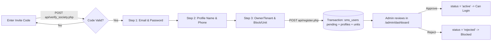
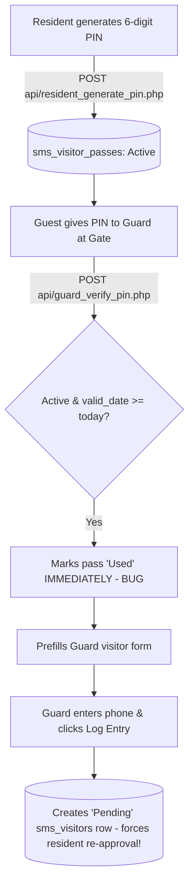

# Core System Workflows

## 1. Authentication & Role Redirection Flow

```mermaid
sequenceDiagram
    actor User
    participant UI as modules/auth/login.php
    participant API as api/login.php
    participant DB as MySQL (sms_users)
    participant Router as routes.php

    User->>UI: Enter email & password
    UI->>API: POST JSON {email, password, csrf_token}
    Note over API: CSRF token currently ignored; no session_regenerate_id
    API->>DB: SELECT user + profile + unit WHERE email = ?
    alt Invalid credentials
        API-->>UI: 401 Invalid email or password
    else status === 'pending' or != 'active'
        API-->>UI: 403 Account pending / suspended
    else Valid & Active
        API->>DB: UPDATE last_login = NOW()
        API->>API: Populate $_SESSION variables
        API-->>UI: 200 {data: {redirect: ""}}
        UI->>Router: Reload /login
        Router->>UI: PHP checks $_SESSION['role_id']
        alt role_id in [1, 2]
            UI-->>User: 302 -> /admin/dashboard
        else role_id == 3 (or 4 - BUG!)
            UI-->>User: 302 -> /resident/dashboard
        end
    end
```

## 2. Resident Onboarding Workflow



## 3. Gate Visitor Logging, Push Alert & Exit Workflow

```mermaid
sequenceDiagram
    actor Guard
    participant G_UI as modules/guard/dashboard.php
    participant LOG as api/guard_log_visitor.php
    participant DB as MySQL (sms_visitors)
    participant Push as WebPush / sw.js
    actor Resident
    participant R_UI as modules/resident/dashboard.php

    Guard->>G_UI: Capture photo + select unit + enter details
    G_UI->>LOG: POST JSON (missing role check & CSRF; phone dropped)
    LOG->>LOG: Write Base64 PNG to uploads/visitors/
    LOG->>DB: INSERT status = 'Pending'
    LOG->>Push: Send VAPID notification (if subscribed)
    LOG-->>G_UI: 200 {success: true, visitor_id}

    par Resident Polls Every 4s
        R_UI->>DB: GET api/resident_get_pending_visitors.php
        R_UI->>Resident: Ring Web Audio Chime + Vibrate
        Resident->>R_UI: Click Approve Entry / Deny
        R_UI->>DB: POST resident_handle_visitor_approval.php -> 'Entered' / 'Denied'
    and Service Worker Action
        Resident->>Push: Tap Approve / Deny on Notification
        Push->>DB: POST api/update_visitor_status.php (UNAUTH!) -> 'Approved' (BUG!) / 'Denied'
    end

    Guard->>G_UI: Click Mark Exit (requires status === 'Entered')
    G_UI->>DB: POST api/guard_visitor_exit.php -> status = 'Exited', exit_time = NOW()
```

## 4. Fast-Track Guest Pass PIN Workflow (Current vs Broken Steps)



## 5. Maintenance Billing & Helpdesk Workflows
- **Billing**: Admin selects single resident or `ALL` → `api/admin_create_invoice.php` inserts `Unpaid` rows in `sms_invoices` → `admin_get_invoices.php` & `resident_get_invoices.php` auto-update past-due bills to `Overdue` on read → Resident visits `/resident/financials` (unlinked from dashboard) → clicks "Pay Now" → `api/resident_pay_invoice.php` marks `Paid` directly without gateway verification.
- **Helpdesk**: Resident submits category/description via modal (`resident_create_complaint.php` → `Open`) → Admin moves card across `Open` ↔ `In Progress` ↔ `Resolved` Kanban columns (`admin_update_complaint.php`).
